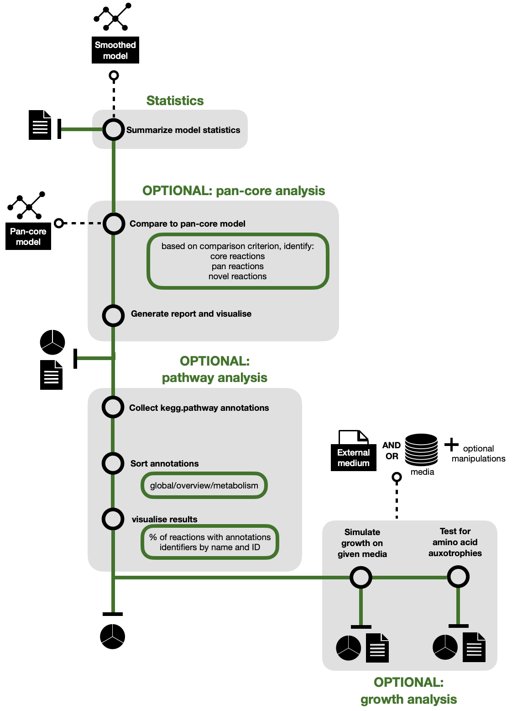

Step 5: Model Analysis
======================

The fifth and final step of the workflow is a short analysis of the curated model, 
generating a set of tables and graphics to nicely display the model content. Most steps, 
excluding the statistical model analysis, are optional and can be skipped.

Current options include:

    a. Statistical analysis
    b. Pathway analysis
    c. Growth analysis, including *in silico* auxotrophy tests
    d. Pan-core analysis, if a pan-core model is available

A graphical overview of the in and outs of this step can be found below.

.. caution:: 

    The pan-core analysis is under heavy rework in its origin package (``refineGEMs``).
    Use at your own discretion.

  Step 5 of HQTB workflow: Model Analysis
