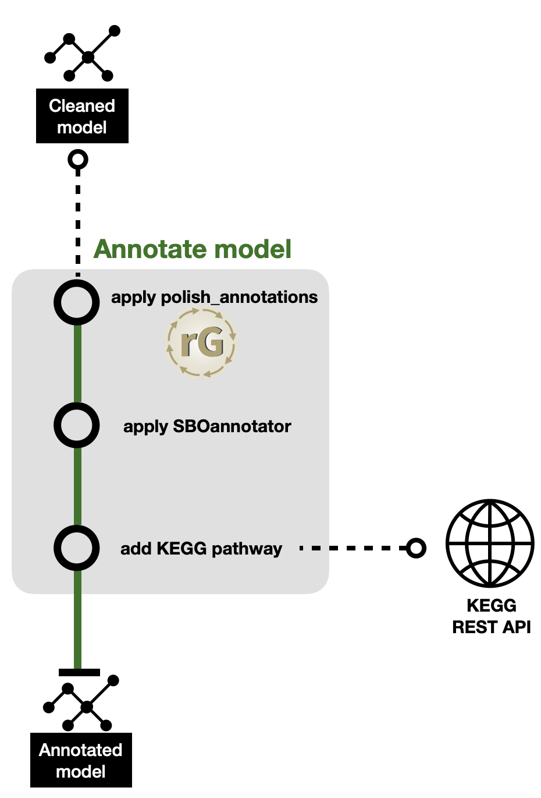

Step 3, Part 3: Further annotate the Model
==========================================

The third part of the refinement aims to improve the annotations of the model.

.. _hqtb_workflow_step3_part3:

  Step 3 of HQTB workflow: Model Refinement. Part 3: Further annotate the Model

As seen in :numref:`hqtb_workflow_step3_part3`, the workflow currently covers:

- Polishing annotations with ``polish_annotations`` from ``refineGEMs``
- SBOterm annotations
- KEGG pathway annotations for reactions

.. hint::

    Our goal is to extend this module with future updates.