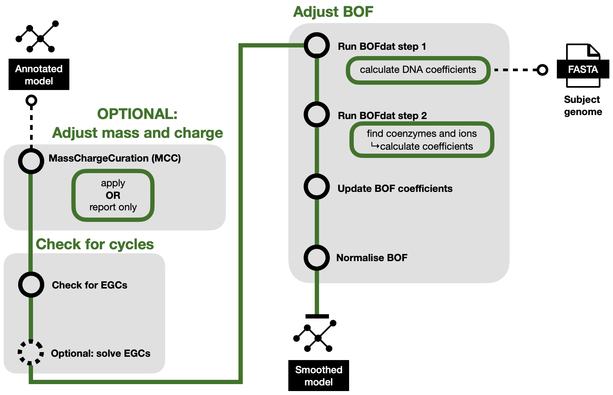

Step 3, Part 4: Smoothing
=========================

The fourth and final part of the refinement step, called smoothing, ajdusts the numerical 
information in the model, inlcuding:

- Adjusting mass and charges using `MCC - MassChargeCuration <https://github.com/Biomathsys/MassChargeCuration/tree/main/MCC>`__
- Checking for and optionally removing EGCs (Energy Generating Cycles)
- Adjusting the BOF (Biomass Objective Function) and normalise the coefficients of the biomass precursors to sum up to 1.0

A graphical overview can be found below.

  Step 3 of HQTB workflow: Model Refinement. Part 4: Smoothing
