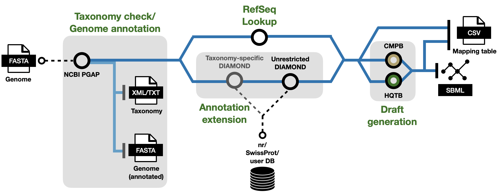

PGAB: From genome sequence to draft model
=========================================

PGAB stands for PGAP-based workflow.

.. note::

    This workflow is under development on the ``pgab-dev`` branch and is planned
    for a future update. The overview below describes the planned workflow.

Starting from a genome sequence, PGAB aims to annotate the genome and extend the
protein annotations with database identifiers before generating a draft model.
Figure :numref:`pgab_workflow` shows the following stages:

1. **Taxonomy check and genome annotation:** Use NCBI's Prokaryotic Genome
   Annotation Pipeline (PGAP) with the genome FASTA file as input. This stage
   produces an annotated FASTA file and taxonomy information in XML/TXT format.
2. **Annotation extension:** Look up RefSeq identifiers and use DIAMOND searches
   to obtain additional protein annotations. The DIAMOND route includes
   taxonomy-specific and unrestricted searches against NCBI's ``nr`` database,
   SwissProt, or a user-provided database.
3. **Draft generation:** Use the extended annotations with either the
   :ref:`CMPB<CMPB Overview>` or :ref:`HQTB<HQTB Overview>` workflow to generate
   the draft model.
4. **Output:** Export the draft model in SBML format and a mapping table in CSV
   format linking the annotated proteins to database identifiers.

.. _pgab_workflow:

  Planned PGAB workflow from a genome sequence to a draft model and a mapping table.
